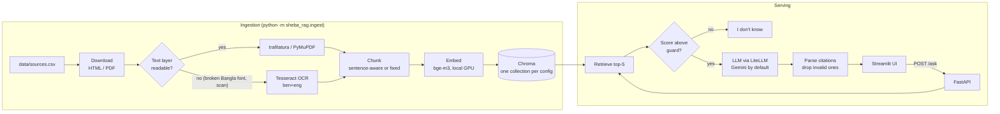

# সেবা সহায়ক · Sheba RAG

A Bangla-first question-answering assistant for Bangladeshi public services (passport, NID, land),
built with retrieval-augmented generation. It answers in the question's language (Bangla or English),
cites the official document and section it used, and says "I don't know" when the documents do not cover
the question.


## Architecture



| Part | Choice | Why |
|---|---|---|
| HTML extraction | trafilatura | Strips portal menus and footers |
| PDF extraction | PyMuPDF, with Tesseract OCR fallback | Most Bangla government PDFs have a broken text layer (see below) |
| Chunking | Own sentence-aware splitter (`।`, `?`, `!`, numbered law sections) vs fixed windows | Generic splitters ignore the danda and cut across law sections |
| Embeddings | `BAAI/bge-m3` (vs `intfloat/multilingual-e5-base`) | Best Bangla and cross-lingual retrieval in our eval |
| Vector DB | Chroma, local | No server; stores section and page metadata for citations |
| LLM | LiteLLM, default `gemini/gemini-3.5-flash-lite` | Any provider is a one-line `.env` change. Lite is the default because the free tier gives `gemini-3.5-flash` only 20 requests a day |
| API / UI | FastAPI, Streamlit | |

## What I learned about Bangladeshi government documents

- **Most Bangla PDFs extract as garbage.** Word-exported PDFs in the Nikosh font have a broken
  character map: PyMuPDF returns "সসবা প্রোন" for "সেবা প্রদান". Older SutonnyMJ PDFs give Latin
  gibberish, and some are scans with no text at all. All 8 Bangla PDFs I tested were affected.
- **A cheap detector catches it.** Correct Bangla never starts a word with a dependent vowel sign and never
  doubles one. The share of such words is 0.0 on clean text and 0.05-0.21 on broken PDFs, so pages above
  0.02 are sent to OCR (`sheba_rag/loaders.py`).
- **Tesseract page segmentation matters.** The default mode drops the spaces between Bangla words;
  `--psm 4` keeps them. OCR of tables still interleaves columns, which is a known limit.
- **Portal HTML hides content.** The NID FAQ puts every question in a bare `<strong>`, which trafilatura
  drops, leaving answers without questions. Converting those tags to paragraphs recovered all 44 questions.
- **Infrastructure quirks.** land.gov.bd advertises an IPv6 address that never answers, and dip.gov.bd (an
  earlier source) sent an incomplete TLS certificate chain. The downloader forces IPv4 and uses the OS trust
  store (`truststore`) instead of disabling verification.
- **The key passport pages block scripts.** epassport.gov.bd is a JavaScript app that refuses scripted requests,
  and fees and the latest rules live only there. Rather than work around its bot protection, the pages were
  saved by hand in a browser into `data/manual/`; `sources.csv` points at those files while citations keep the
  official URL and the date saved.
- **Sources disagree over time.** The older dip.gov.bd copy of the passport rules said applicants over 65 get a
  5-year passport and that super-urgent delivery needs a police clearance. The current epassport.gov.bd page
  cancels both. With both indexed the assistant could contradict itself, so the outdated page was removed.
- **Numbered lists are not law sections.** Treating every numbered line as a section turned the list of 70+
  passport offices into 140 chunks like "2. Jatrabari". Short sections are now packed together until a chunk
  reaches 300 characters, with range labels such as "§ 1–13".

## Corpus

| Service | Source | Lang | Type |
|---|---|---|---|
| Passport | [e-Passport fees](https://www.epassport.gov.bd/instructions/passport-fees), inside Bangladesh and at missions | en | HTML, saved by hand |
| Passport | [ই-পাসপোর্ট ফরম পূরণের নির্দেশাবলী](https://www.epassport.gov.bd/instructions/instructions) (application rules) | bn | HTML, saved by hand |
| Passport | [Documents checklist for e-Passport enrollment](https://www.epassport.gov.bd/landing/notices/160) | bn | HTML, saved by hand |
| Passport | [e-Passport required documents](https://www.epassport.gov.bd/landing/notices/34) | en, bn | HTML, saved by hand |
| Passport | [List of functional e-Passport offices](https://www.epassport.gov.bd/landing/notices/33) (last updated 2023) | en | HTML, saved by hand |
| Passport | [5 steps to your e-Passport](https://www.epassport.gov.bd/instructions/five-step-to-your-epassport) | en | HTML, saved by hand |
| Passport | [Bangladesh Passport Order 1973](http://bdlaws.minlaw.gov.bd/act-print-445.html) | en | HTML |
| NID | [NID FAQ](https://services.nidw.gov.bd/nid-pub/faq?tab=faq-general), Election Commission | bn | HTML |
| NID | [জাতীয় পরিচয় নিবন্ধন আইন, ২০২৩](http://bdlaws.minlaw.gov.bd/act-print-1458.html) | bn | HTML |
| Land | [ভূমিসেবার নির্ধারিত ফি](https://land.gov.bd/vumisheba-fee?lang=bn) | bn | HTML |
| Land | [ভূমি উন্নয়ন কর আইন, ২০২৩](http://bdlaws.minlaw.gov.bd/act-print-1449.html) | bn | HTML |
| Land | Ministry of Land citizen charter, 53 pages | bn | PDF, OCR |

Keeping the corpus current:
- **Downloaded pages** are cached in `data/raw`. Run `python -m sheba_rag.ingest --refresh` to download them
  again; a failed download keeps the last good copy.
- **Hand-saved pages** (epassport.gov.bd, saved on 2026-11-10) go stale when the site changes. Save the page
  again over the old file and run ingestion: it stops and prints the file's new `sha1`. Put that and the new
  `saved` date in `data/sources.csv`, then run ingestion again. Citations show the saved date, so this check
  keeps it true.

Add a document by dropping a row into `data/sources.csv` and re-running ingestion. For a page that blocks
scripts, save it from your browser into `data/manual/` and fill in the `file`, `saved` and `sha1` columns
(ingestion prints the `sha1` to use); the `url` column stays the official address used in citations.

## Setup (Windows, tested; Linux/macOS similar)

Requirements: Python 3.11+, [Tesseract](https://github.com/UB-Mannheim/tesseract/wiki) with the Bengali
(`ben`) language pack, a free [Gemini API key](https://aistudio.google.com/apikey). A CUDA GPU is optional;
bge-m3 runs in fp16 on a 4 GB laptop GPU.

```powershell
python -m venv .venv
.venv\Scripts\activate
pip install torch==2.14.1 --index-url https://download.pytorch.org/whl/cu126   # skip on CPU-only machines
pip install -r requirements.txt
copy .env.example .env      # then put your GEMINI_API_KEY in .env

python -m sheba_rag.ingest  # downloads sources, OCRs PDFs (~2 min once), builds the index
```

Run the app in two terminals:

```powershell
uvicorn api.main:app --port 8000
streamlit run ui/app.py
```

API example:

```powershell
curl.exe -X POST localhost:8000/ask -H "Content-Type: application/json" -d "{\"question\": \"What is the NID helpline number?\"}"
```

Tests (no network or API key needed): `pytest`

## Evaluation

`eval/testset.jsonl` has 34 questions: 29 answerable (12 passport, 9 NID, 8 land; 8 in English, several
asking in English about Bangla-only sources) and 5 unanswerable ones, some deliberately close to the corpus
(for example the NID reissue fee, which no source states). Each answerable item has an expected answer, the
expected document, and an evidence phrase copied from the source.

```powershell
python -m sheba_rag.ingest --chunker all --embed BAAI/bge-m3 --embed intfloat/multilingual-e5-base
python -m eval.run_eval retrieval                     # all chunker x embedding pairs, no LLM calls
python -m eval.run_eval generate --config sentence:BAAI/bge-m3 --config fixed:BAAI/bge-m3
```

Metrics:
- **hit@k / MRR**: the expected document is among the top-k chunks.
- **evidence@5**: the exact answering sentence is inside one of the top-5 chunks. This is stricter, and
  it is the metric that separates chunkers.
- **correctness**: an LLM judge (`gemini-3.1-flash-lite`, a different model from the answerer) checks the
  answer against the expected answer.
- **groundedness**: the same judge checks every claim is supported by the retrieved context.
- **abstain on unanswerable / false "I don't know"**: how often the system declines when it should, and
  when it should not.

### Results

Retrieval, 29 answerable questions, top-5:

| chunker | embedding | hit@1 | hit@5 | MRR | evidence@5 |
|---|---|---|---|---|---|
| sentence | bge-m3 | 0.90 | 1.00 | 0.94 | **1.00** |
| fixed | bge-m3 | 0.93 | 0.97 | 0.94 | 0.93 |
| sentence | multilingual-e5-base | 0.83 | 0.90 | 0.85 | 0.83 |
| fixed | multilingual-e5-base | 0.72 | 0.90 | 0.80 | 0.83 |

Answers, all 34 questions, LLM `gemini/gemini-3.5-flash-lite`, judge `gemini/gemini-3.1-flash-lite`:

| run | chunker | correctness | groundedness | abstain on unanswerable | false "I don't know" |
|---|---|---|---|---|---|
| 1. original prompt | sentence | 0.93 | 1.00 | 1.00 | 0.07 |
| 1. original prompt | fixed | 1.00 | 0.97 | 1.00 | 0.00 |
| 2. revised prompt | sentence | 0.97 | 0.97 | 1.00 | 0.00 |
| 2. revised prompt | fixed | 1.00 | 1.00 | 1.00 | 0.00 |
| 3. revised prompt, table-aware chunks (current) | sentence | 1.00 | 1.00 | 1.00 | 0.00 |
| 3. revised prompt, table-aware chunks (current) | fixed | 0.97 | 1.00 | 1.00 | 0.03 |

All runs use bge-m3. Per-question answers and verdicts for run 3 are in `eval/results.jsonl`; every run's
table is in `eval/results.md`.

**Read these scores as optimistic, for two reasons.**
- *The system was tuned on this test set.* After run 1 wrongly refused two fee questions and garbled a
  price, I added two prompt rules (give every matching case and add up listed parts; copy numbers exactly).
  After run 2 read the wrong row of the fee table, I changed the sentence chunker to keep table rows with
  their headings. Both changes were checked on the failing questions before the full re-run. A fair measure
  needs questions the system was not tuned on.
- *The judge missed an error in run 3.* I read the fee answers by hand. For the 10-year 48-page passport, the
  sentence-chunk answer gives the right fees inside Bangladesh but states USD 100 for general applicants at
  missions; the page says USD 125. The judge graded it correct and grounded. Counting that, sentence chunks
  have 28 of 29 answers fully correct, not 29.

Findings:
- **The embedding model matters most.** bge-m3 beats multilingual-e5-base by 7-21 points on the hit and
  evidence metrics, and it handles English questions about Bangla documents well.
- **Sentence-aware chunking helps retrieval a little; the answer scores cannot separate the chunkers.** With
  the stricter evidence check, fixed windows lose answers that were cut across a window boundary. At the
  answer stage the two setups differ by one or two questions out of 29 in every run, in either direction, which
  this test set cannot tell from noise. Fixed chunks changed between runs 2 and 3 without any change to
  their code: the source titles are embedded with each chunk, their wording changed slightly, and one
  question ("can someone else collect my passport?") dropped out of the top 5 and was refused.
- **A strict "answer only from context" prompt over-refuses.** The first run refused "what is the total
  mutation fee?" because the page lists three parts and no total, and refused the passport fee question
  because the context held several matching cases (inside Bangladesh, missions abroad, three delivery
  types). The right text was retrieved both times. Telling the model to give each case and to add up listed
  parts fixed both without making it answer the unanswerable questions.
- **Flattened tables need table-aware chunking.** The fee page is a nested list: a group ("inside
  Bangladesh", "Mission's Labors and Students"), a passport type, then price rows. Plain sentence packing
  cut rows off from their headings: one chunk started with "- Regular delivery : USD 50" and no passport
  type, and in run 2 the model answered TK 6,325 (regular) for an express price that is TK 8,625. Carrying
  each row's headings into its chunk fixed that question, but the fees inside Bangladesh were still buried
  at the end of a chunk about paying at a bank, and the model then answered only from the mission fees.
  Starting a new chunk where a table begins gave each fee group its own chunk and fixed that too.
- **Even with clean chunks the small model mixes up neighbouring figures.** In run 3 it copied USD 100, the
  5-year price, into a 10-year answer. A stronger model or a check of every quoted figure against the cited
  chunk is the next step for fee answers.
- **The small model garbles numbers.** Before the "copy numbers exactly" rule, `gemini-3.5-flash-lite` wrote
  "৮,০৫৮ টাকা (অথবা ৮,০৫০ টাকা)" for TK 8,050 and "১০,৩৫টা" for 10,350 when converting digits to Bangla.
  With the rule it copies figures as "TK 8,050".
- **The judge is lenient.** It passed the wrong USD figure above. And for "when is land development tax due
  without penalty?", the fixed-chunk answer still starts mid-word ("ত বৎসরের ৩০ জুন...") and describes when
  tax becomes overdue instead of stating the 30 June deadline, yet it was graded correct in every run. A
  stricter judge is needed to compare answer quality.
- **Abstention works.** All 5 unanswerable questions got "I don't know" in every run, including the NID
  reissue fee and an emergency travel permit fee, which sit close to the corpus.
- **A similarity cutoff cannot replace the LLM's judgement.** With bge-m3, the lowest-scoring answerable
  question (an English question about a Bangla fee table) scored 0.48, below all five unanswerable questions
  (0.51-0.67). The cutoff is therefore only a guard at 0.40 against clearly off-topic questions; the prompt's
  abstain instruction and the "no citation means no answer" rule do the real work.
- **Run-to-run noise was a bug.** Chroma's default `ef_search=10` made top-5 results change between identical
  runs. Raising it to 200, effectively exact search at this size, made results reproducible.

Caveats: 34 questions is a small test set, so one question moves a score by 3-4 points. The answer run used
the free-tier `gemini-3.5-flash-lite`; `gemini-3.5-flash` was not evaluated because of its 20-requests-a-day cap. I drafted the
expected answers from the sources; they should be reviewed by someone who uses these services. An LLM judge
can be wrong; per-question verdicts are in `eval/results.jsonl` for inspection.

## Project layout

```
sheba_rag/   config.py  loaders.py  chunking.py  store.py  ingest.py  answer.py
api/main.py  FastAPI: POST /ask, GET /health
ui/app.py    Streamlit chat UI
eval/        testset.jsonl  run_eval.py  results.md
tests/       unit tests (chunking, loaders, answer logic, API)
data/        sources.csv, manual/ (hand-saved pages); downloads, extracted text and the index are generated
```

## Limitations and next steps

- The corpus is small, and the hand-saved epassport.gov.bd pages have to be re-saved by hand when the site
  changes. Step-by-step mutation instructions from upazila land offices are still missing.
- Table-aware OCR would make the citizen charter's fee and timeline tables much cleaner.
- Hybrid search (BM25 plus vectors) would likely help exact terms such as fee names and section numbers.
- Gemini's free tier is tight: 5 requests per minute per model, and a daily cap that was 20 requests for
  `gemini-3.5-flash`. The API returns a clear 429 message when a limit is hit. The eval script paces calls,
  retries transient errors, and resumes from `eval/results.jsonl`, so a run interrupted by a quota costs no
  repeated calls.

This is a portfolio project, not legal advice. Always confirm with the relevant office.
