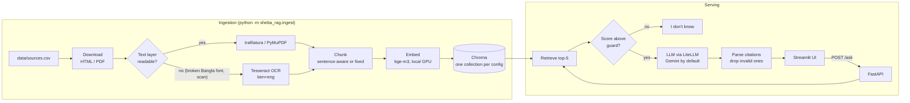

# সেবা সহায়ক · Sheba RAG

A Bangla-first question-answering assistant for Bangladeshi public services (passport, NID, land),
built with retrieval-augmented generation. It answers in the question's language (Bangla or English),
cites the official document and section it used, and says "I don't know" when the documents do not cover
the question.


## Architecture



| Part | Choice | Why |
|---|---|---|
| HTML extraction | trafilatura | Strips portal menus and footers |
| PDF extraction | PyMuPDF, with Tesseract OCR fallback | Most Bangla government PDFs have a broken text layer (see below) |
| Chunking | Own sentence-aware splitter (`।`, `?`, `!`, numbered law sections) vs fixed windows | Generic splitters ignore the danda and cut across law sections |
| Embeddings | `BAAI/bge-m3` (vs `intfloat/multilingual-e5-base`) | Best Bangla and cross-lingual retrieval in our eval |
| Vector DB | Chroma, local | No server; stores section and page metadata for citations |
| LLM | LiteLLM, default `gemini/gemini-3.5-flash-lite` | Any provider is a one-line `.env` change. Lite is the default because the free tier gives `gemini-3.5-flash` only 20 requests a day |
| API / UI | FastAPI, Streamlit | |

## What I learned about Bangladeshi government documents

- **Most Bangla PDFs extract as garbage.** Word-exported PDFs in the Nikosh font have a broken
  character map: PyMuPDF returns "সসবা প্রোন" for "সেবা প্রদান". Older SutonnyMJ PDFs give Latin
  gibberish, and some are scans with no text at all. All 8 Bangla PDFs I tested were affected.
- **A cheap detector catches it.** Correct Bangla never starts a word with a dependent vowel sign and never
  doubles one. The share of such words is 0.0 on clean text and 0.05-0.21 on broken PDFs, so pages above
  0.02 are sent to OCR (`sheba_rag/loaders.py`).
- **Tesseract page segmentation matters.** The default mode drops the spaces between Bangla words;
  `--psm 4` keeps them. OCR of tables still interleaves columns, which is a known limit.
- **Portal HTML hides content.** The NID FAQ puts every question in a bare `<strong>`, which trafilatura
  drops, leaving answers without questions. Converting those tags to paragraphs recovered all 44 questions.
- **Infrastructure quirks.** land.gov.bd advertises an IPv6 address that never answers, and dip.gov.bd sends
  an incomplete TLS certificate chain. The downloader forces IPv4 and uses the OS trust store (`truststore`)
  instead of disabling verification.

## Corpus

| Service | Source | Lang | Type |
|---|---|---|---|
| Passport | [পাসপোর্ট পেতে করণীয়](https://dip.gov.bd/pages/static-pages/6922dc55933eb65569e0fc65), Department of Immigration and Passports | bn | HTML |
| Passport | [Bangladesh Passport Order 1973](http://bdlaws.minlaw.gov.bd/act-print-445.html) | en | HTML |
| NID | [NID FAQ](https://services.nidw.gov.bd/nid-pub/faq?tab=faq-general), Election Commission | bn | HTML |
| NID | [জাতীয় পরিচয় নিবন্ধন আইন, ২০২৩](http://bdlaws.minlaw.gov.bd/act-print-1458.html) | bn | HTML |
| Land | [ভূমিসেবার নির্ধারিত ফি](https://land.gov.bd/vumisheba-fee?lang=bn) | bn | HTML |
| Land | [ভূমি উন্নয়ন কর আইন, ২০২৩](http://bdlaws.minlaw.gov.bd/act-print-1449.html) | bn | HTML |
| Land | Ministry of Land citizen charter, 53 pages | bn | PDF, OCR |

Add a document by dropping a row into `data/sources.csv` and re-running ingestion.

## Setup (Windows, tested; Linux/macOS similar)

Requirements: Python 3.11+, [Tesseract](https://github.com/UB-Mannheim/tesseract/wiki) with the Bengali
(`ben`) language pack, a free [Gemini API key](https://aistudio.google.com/apikey). A CUDA GPU is optional;
bge-m3 runs in fp16 on a 4 GB laptop GPU.

```powershell
python -m venv .venv
.venv\Scripts\activate
pip install torch --index-url https://download.pytorch.org/whl/cu126   # skip on CPU-only machines
pip install -r requirements.txt
copy .env.example .env      # then put your GEMINI_API_KEY in .env

python -m sheba_rag.ingest  # downloads sources, OCRs PDFs (~2 min once), builds the index
```

Run the app in two terminals:

```powershell
uvicorn api.main:app --port 8000
streamlit run ui/app.py
```

API example:

```powershell
curl.exe -X POST localhost:8000/ask -H "Content-Type: application/json" -d "{\"question\": \"What is the NID helpline number?\"}"
```

Tests (no network or API key needed): `pytest`

## Evaluation

`eval/testset.jsonl` has 30 questions: 25 answerable (8 passport, 9 NID, 8 land; 6 in English, several
asking in English about Bangla-only sources) and 5 unanswerable ones, some deliberately close to the corpus
(for example the passport fee, which no source states). Each answerable item has an expected answer, the
expected document, and an evidence phrase copied from the source.

```powershell
python -m sheba_rag.ingest --chunker all --embed BAAI/bge-m3 --embed intfloat/multilingual-e5-base
python -m eval.run_eval retrieval                     # all chunker x embedding pairs, no LLM calls
python -m eval.run_eval generate --config sentence:BAAI/bge-m3 --config fixed:BAAI/bge-m3
```

Metrics:
- **hit@k / MRR**: the expected document is among the top-k chunks.
- **evidence@5**: the exact answering sentence is inside one of the top-5 chunks. This is stricter, and
  it is the metric that separates chunkers.
- **correctness**: an LLM judge (`gemini-3.1-flash-lite`, a different model from the answerer) checks the
  answer against the expected answer.
- **groundedness**: the same judge checks every claim is supported by the retrieved context.
- **abstain on unanswerable / false "I don't know"**: how often the system declines when it should, and
  when it should not.

### Results

Retrieval, 25 answerable questions, top-5:

| chunker | embedding | hit@1 | hit@5 | MRR | evidence@5 |
|---|---|---|---|---|---|
| sentence | bge-m3 | 0.96 | 1.00 | 0.98 | **1.00** |
| fixed | bge-m3 | 0.96 | 1.00 | 0.97 | 0.96 |
| sentence | multilingual-e5-base | 0.88 | 0.92 | 0.89 | 0.88 |
| fixed | multilingual-e5-base | 0.84 | 0.92 | 0.88 | 0.84 |

Answers, all 30 questions, LLM `gemini/gemini-3.5-flash-lite`, judge `gemini/gemini-3.1-flash-lite`:

*Pending: the run is paced for Gemini's free tier and resumes from `eval/results.jsonl`. The first 5
questions were all correct and grounded.*

Findings:
- **The embedding model matters most.** bge-m3 beats multilingual-e5-base by 8-12 points on every metric,
  and it handles English questions about Bangla documents well.
- **Sentence-aware chunking helps a little.** At document level the chunkers tie. With the stricter
  evidence check, fixed windows lose an answer that was cut across a window boundary.
- **A similarity cutoff cannot replace the LLM's judgement.** With bge-m3, the lowest-scoring answerable
  question (an English question about a Bangla fee table) scored 0.43, below three unanswerable questions
  (0.51-0.62). The cutoff is therefore only a guard at 0.40 against clearly off-topic questions; the prompt's
  abstain instruction and the "no citation means no answer" rule do the real work.
- **Run-to-run noise was a bug.** Chroma's default `ef_search=10` made top-5 results change between identical
  runs. Raising it to 200, effectively exact search at this size, made results reproducible.

Caveats: 30 questions is a small test set, so one question moves a score by 3-4 points. I drafted the
expected answers from the sources; they should be reviewed by someone who uses these services. An LLM judge
can be wrong; per-question verdicts are in `eval/results.jsonl` for inspection.

## Project layout

```
sheba_rag/   config.py  loaders.py  chunking.py  store.py  ingest.py  answer.py
api/main.py  FastAPI: POST /ask, GET /health
ui/app.py    Streamlit chat UI
eval/        testset.jsonl  run_eval.py  results.md
tests/       unit tests (chunking, loaders, answer logic, API)
data/        sources.csv (raw files, extracted text and the index are generated, not committed)
```

## Limitations and next steps

- The corpus is small. Passport fees and step-by-step e-passport instructions live on epassport.gov.bd,
  which blocks scripted downloads.
- Table-aware OCR would make the citizen charter's fee and timeline tables much cleaner.
- Hybrid search (BM25 plus vectors) would likely help exact terms such as fee names and section numbers.
- Gemini's free tier is tight: 5 requests per minute per model, and a daily cap that was 20 requests for
  `gemini-3.5-flash`. The API returns a clear 429 message when a limit is hit. The eval script paces calls,
  retries transient errors, and resumes from `eval/results.jsonl`, so a run interrupted by a quota costs no
  repeated calls.

This is a portfolio project, not legal advice. Always confirm with the relevant office.
